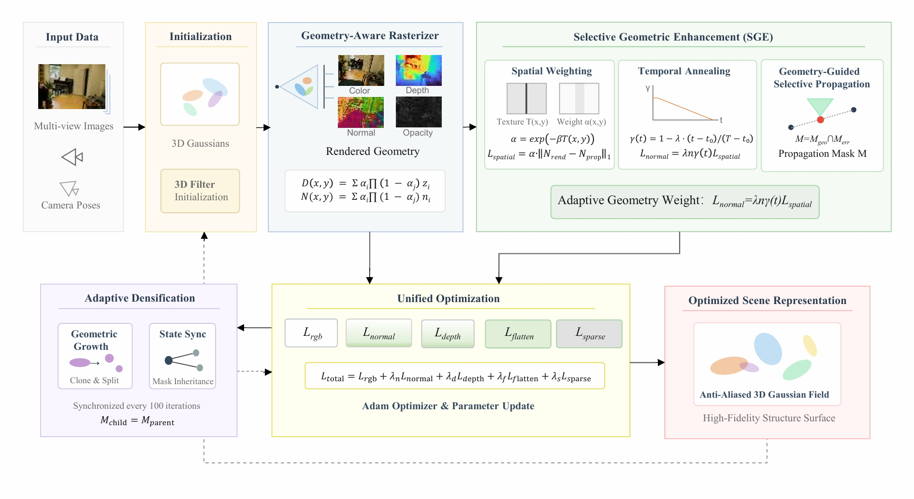

# Selective Geometric Enhancement for 3D Gaussian Splatting Reconstruction

This repository contains the implementation of **Selective Geometric Enhancement (SGE-GS)**, a method for improving the geometric quality of 3D Gaussian Splatting (3DGS) reconstructions, particularly in texture-sparse regions.

**Paper:** *Selective Geometric Enhancement for 3D Gaussian Splatting Reconstruction*  
**Journal:** Signal Processing: Image Communication, 2026, Article 117740  
**DOI:** [10.1016/j.image.2026.117740](https://doi.org/10.1016/j.image.2026.117740)
## Method Overview




## Overview

3D Gaussian Splatting enables efficient novel-view synthesis, but its reconstructed geometry can remain inaccurate in regions with limited texture.

SGE-GS introduces selective geometric supervision to improve geometric consistency while avoiding excessive geometric constraints in highly textured regions. Built upon Mip-Splatting, the method combines adaptive geometric supervision with MVS-guided geometric information propagation.

The main components are:

- **Texture-aware geometric supervision:** Adjusts geometric supervision according to local texture complexity.
- **Progressive supervision scheduling:** Gradually adjusts the geometric supervision weight during training.
- **MVS-guided selective propagation:** Uses multi-view stereo (MVS) information and depth residuals to guide the propagation of geometric information.
- **Geometry-aware rendering:** Provides color, depth, and surface-normal outputs for geometric supervision.

## Method

### Texture-aware and progressive supervision

Let \(T\) denote local image texture complexity, estimated from image gradients:

\[
T = \left|\frac{\partial I}{\partial x}\right|
  + \left|\frac{\partial I}{\partial y}\right|.
\]

The texture-aware weight is defined as

\[
\alpha = \exp(-\beta T),
\]

where \(\beta\) controls the sensitivity to local texture complexity. This weighting gives greater emphasis to geometric supervision in texture-sparse regions.

The supervision weight is also adjusted over the course of training.

### MVS-guided selective propagation

The method uses MVS-derived geometric information and depth residuals to guide selective propagation. Geometric consistency across neighboring views is used to identify suitable candidates for propagation.

Together, these components aim to improve reconstructed geometry without imposing the same geometric constraints uniformly across the scene.

## Installation

The reference environment used for the experiments was:

- OS: Linux
- Python: 3.9.25
- PyTorch: 2.0.1
- CUDA toolkit build: 11.8
- GPU: NVIDIA GeForce RTX 4090 (24 GB)

The project includes CUDA/C++ extensions, so a compatible NVIDIA GPU environment, CUDA toolchain, and PyTorch installation are required.

### 1. Clone the repository

```bash
git clone https://github.com/izumi01-n/SGE-GS.git
cd SGE-GS
```

### 2. Create the environment

```bash
conda create -n sge-gs python=3.9
conda activate sge-gs
```

Install a PyTorch build compatible with CUDA 11.8:

```bash
pip install torch==2.0.1 torchvision==0.15.2 \
  --index-url https://download.pytorch.org/whl/cu118
```

Install the Python dependencies listed in the repository:

```bash
pip install -r requirements.txt
```

The repository uses CUDA/C++ extensions. Ensure that the required extensions, including the Gaussian rasterizer and the propagation extension, are built and importable in your environment before training. Extension compilation may depend on your local CUDA toolkit and compiler configuration.

## Dataset Preparation

The experiments use the **Mip-NeRF 360 dataset**.

Download and prepare the dataset following the instructions provided by the original dataset authors. Set `--source_path` to the directory of the scene to be trained.

A typical scene directory contains the input images and the corresponding camera/sparse reconstruction data required by the 3DGS data loader.

For example, if the scene is stored at `data/360_v2/garden`, use that directory as the source path in the training command below.

Dataset files are not included in this repository.

## Training

The following command uses the parameters from the paper's experimental configuration.

```bash
python train.py \
  --source_path data/360_v2/garden \
  --model_path output/SGE-GS/garden \
  --iterations 30000 \
  --dataset free \
  --densify_grad_threshold 0.0004 \
  --propagation_interval 200 \
  --patch_size 36 \
  --flatten_loss \
  --depth_loss \
  --normal_loss \
  --propagated_iteration_begin 4000 \
  --propagated_iteration_after 15000 \
  --normal_iter_start 4000 \
  --lambda_l1_normal 0.15 \
  --lambda_depth 0.2 \
  --lambda_flatten 2.0 \
  --depth_error_threshold 0.05
```

Replace the example scene path with the path to your own dataset scene. The output model and training artifacts are saved under `--model_path`.

The command above enables normal, depth, and flattening losses and specifies the geometric propagation schedule and loss weights used in the experiments.

## Rendering

After training, render the reconstructed scene using the project's rendering script:

```bash
python render.py \
  --model_path output/SGE-GS/garden \
  --iteration 30000
```

The rendering script also supports options for selecting the iteration and skipping train or test views. Run `python render.py --help` to see the available options.

## Evaluation

The project includes evaluation-related scripts for image quality and geometric analysis. Evaluation requirements and available metrics depend on the specific script and dataset.

Use the evaluation procedures described in the paper when reproducing the reported results. Ensure that the model path, iteration, dataset paths, and required ground-truth data are configured correctly for the selected evaluation script.

## Citation

If you use this work in your research, please cite the paper:

```bibtex
@article{han2026selective,
  title   = {Selective Geometric Enhancement for 3D Gaussian Splatting Reconstruction},
  author  = {Han, Tongrui and Liang, Jiong and Wang, Xi and Wang, Jiali},
  journal = {Signal Processing: Image Communication},
  year    = {2026},
  doi     = {10.1016/j.image.2026.117740}
}
```

## Acknowledgements

This project builds upon prior work on 3D Gaussian Splatting and Mip-Splatting. Please also refer to the original projects for their methods, implementation details, and licenses.

## Results

